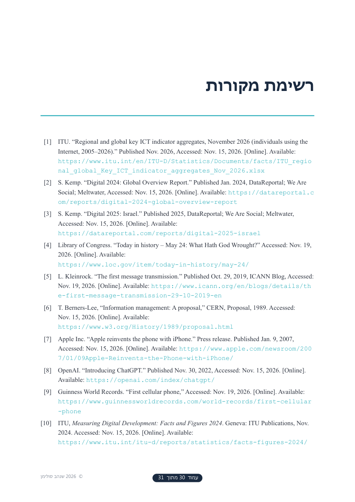
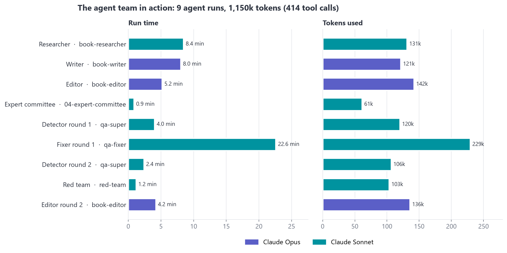

<div dir="rtl">

# 📱 מחוברים תמיד: טכנולוגיה וחיי היומיום
### *Always Connected: Technology and Everyday Life*

ספר מקצועי בעברית ואנגלית משולבת, ברמת הוצאה לאור, 33 עמודים. הוא הופק כולו בקוד:
- **LuaLaTeX**, עם תבנית `.cls` משלי
- **Python** לגרפים ולאיורים
- **TikZ** לתרשימים

את העבודה עשה **צוות של 8 תפקידי סוכנים** (ועדת מומחים, חוקר, כותב, עורך, מגיה, Detector, Fixer וצוות אדום), ומעליהם סוכן Master. כל תיקון עבר דרך תבנית או Skill, ולא נגעו בטקסט ביד.

📕 **[book.pdf](book.pdf)**: הספר הסופי &nbsp;·&nbsp; 📋 **[PRD.md](PRD.md)** &nbsp;·&nbsp; 🗺️ **[PLAN.md](PLAN.md)** &nbsp;·&nbsp; ✅ **[TODO.md](TODO.md)** &nbsp;·&nbsp; 📝 [book.docx](book.docx) (גרסת Word לקריאה)

> **הקול האישי:** הספר נכתב **בהשראת הסגנון של יובל נח הררי**: מבט היסטורי רחב, משפטים קצרים ושאלות פתוחות לקורא.
> **השפה העיצובית היא של "מסך":** כחול-לילה למסך כבוי, טורקיז למסך דולק, ו**נקודת התראה אדומה** שחוזרת בשער, בכותרות הפרקים ובבאנר.

---

## 🖼️ מתוך הספר

| שער | פתיחת פרק + באנר | תרשים בלוקים (TikZ, 8 שלבים) |
|:---:|:---:|:---:|
|  |  |  |
| **נוסחה בתיבה + גרף Python** | **טבלה: ציר זמן** | **תיבת קוד (pythonbox)** |
|  |  |  |
| **תוכן עניינים** | **רשימת תיוג ותיבות** | **מקורות IEEE** |
|  |  |  |

**איורים וגרפים**, כולם נוצרו בקוד ואין בהם תמונה מהאינטרנט:

<p align="center">
&nbsp;
</p>

---

## 🤖 צוות הסוכנים בפעולה

<p align="center"></p>
<p align="center"><em>נתוני ריצה אמיתיים של כל סוכן: זמן, טוקנים ומודל (מתוך <a href="docs/agent-runs.json">docs/agent-runs.json</a>)</em></p>

```
                          ┌───────────────────────────────┐
                          │    MASTER (מנהל, Opus)         │
                          │ תבנית · גרפים · אינטגרציה · Git │
                          └───────────────┬───────────────┘
   ┌──────────────┬───────────────┬───────┴──────┬───────────────────────────────┐
   ▼              ▼               ▼              ▼                               ▼
┌────────┐   ┌─────────┐    ┌──────────┐   ┌──────────┐          ┌──────────────────────────────┐
│ ועדת   │   │ חוקר    │──▶│ כותב      │──▶│ עורך      │──────▶  │    לולאת "צוות אדום"           │
│ מומחים │   │ Sonnet  │    │ Opus     │   │ Opus     │          │ Detector ──▶ Fixer ──▶ Detector │
│ →PRD   │   │ 16 מקורות│    │ 9 פרקים  │   │ 19 תיקונים│          │ (qa-super)  (qa-fixer) (אימות) │
└────────┘   └─────────┘    └──────────┘   └──────────┘          │        + red-team (בוחן)      │
                                                                  └──────────────────────────────┘
```

| סוכן | Skill | מודל | מה עשה |
|------|-------|------|--------|
| **ועדת מומחים** | [04-expert-committee](prompts/04-expert-committee.md) | Sonnet | 5 מומחים, 28 קריטריוני קבלה מדידים, והם הבסיס ל-PRD ([docs/expert-committee.md](docs/expert-committee.md)) |
| **חוקר** | [book-researcher](.claude/skills/book-researcher/SKILL.md) | Sonnet | 16 מקורות אמיתיים, וגיליון עובדות שמסמן מה **לא** אומת |
| **כותב** | [book-writer](.claude/skills/book-writer/SKILL.md) | Opus | 9 פרקים בסגנון הררי, רק עם נתונים מאומתים |
| **עורך** | [book-editor](.claude/skills/book-editor/SKILL.md) | Opus | 19 תיקוני עובדות ושפה, וציון 7.5/10 |
| **Detector** | [qa-super](.claude/skills/qa-super/SKILL.md) + 7 סקילים | Sonnet | מגלה תקלות ואינו מתקן |
| **Fixer** | [qa-fixer](.claude/skills/qa-fixer/SKILL.md) | Sonnet | מתקן במקום הנכון: תבנית, סקיל או שורה בודדת |
| **צוות אדום** | [red-team](.claude/skills/red-team/SKILL.md) | Sonnet | מחפש את 10 נקודות התורפה של הספר, בלי מחמאות |

**ניהול משאבים:** משימות של חיפוש ובדיקה רצו על Sonnet, שזול יותר. כתיבה ועריכה בעברית רצו על Opus. כל הסוכנים רצו ברקע, במקביל לעבודת ה-Master.

---

## 🔴 לולאת בקרת האיכות: Detector ⇄ Fixer

| סבב | מי | תוצאה | דוח |
|-----|----|-------|-----|
| 1 | Detector | 0 קריטיים · 6 מהותיים · 10 קלים, **NOT READY** | [detector-round-1](qa/reports/detector-round-1.md) |
| 1 | Fixer | 15 תוקנו, 1 פתוח (קל ומתועד). התבנית עלתה ל-v2.4.0 | [fixer-round-1](qa/reports/fixer-round-1.md) |
| 2 | Detector | 15 תיקונים אומתו, 0 נסיגות. 1 מהותי ו-6 קלים חדשים | [detector-round-2](qa/reports/detector-round-2.md) |
| — | red-team | 10 נקודות תורפה בתוכן ובטיעון | [red-team](qa/reports/red-team.md) |
| 2 | עורך + Master | תיקון נקודות הצוות האדום בתוכן. התבנית עלתה ל-v2.5.0 | [editor-report](research/editor-report.md) |
| 3 | Detector (שער סופי) | כל ממצאי סבב 2 אומתו, 0 נסיגות. 1 מהותי ו-3 קלים | [detector-round-3](qa/reports/detector-round-3.md) |
| 3 | Master | כל ממצאי סבב 3 תוקנו. התבנית עלתה ל-v2.5.1 | [CHANGELOG](template/CHANGELOG.md) |
| 4 | מגיה + Detector מחמיר | הגהה מלאה של העברית, וסימולציה של בודק קפדני | [detector-round-4](qa/reports/detector-round-4.md) |

**חוק הברזל:** כל תיקון שחוזר בכמה מקומות בספר בוצע ב-[connected.cls](connected.cls), ו**הגרסה עלתה**. היסטוריית הגרסאות נמצאת ב-[CHANGELOG](template/CHANGELOG.md). כשה-Detector מצא תקלה שהבודק האוטומטי פספס, הבודק עצמו ([qa/qa_check.py](qa/qa_check.py)) תוקן כדי שיתפוס אותה בפעם הבאה.

### 🔍 חקרי אירוע
לכל תקלה נשאלו שתי שאלות: **למה היא קרתה**, ו**למה היא לא התגלתה קודם**. מהתשובות נגזר מנגנון המניעה. **16 חקרי אירוע** נמצאים ב-[docs/incidents.md](docs/incidents.md), ומתוכם, למשל:
- **INC-05:** סקריפט Python כתב `\r`, `\f` ו-`\b` כתווי בקרה בקובצי LaTeX, **שלוש פעמים**. הלקח נשאר הערה בפרומפט ולא הפך לבדיקה, ולכן לא נעצר. עכשיו `qa-infra` סורק כל קובץ.
- **INC-11:** הגרסה הראשונה נבנתה לפי תמלול משובש של השיעור, עם XeLaTeX ו-APA, במקום המסמך הרשמי (LuaLaTeX ו-IEEE). העורך בדק את הספר **מול אותו PRD שגוי**, ולכן לא תפס את הטעות.
- **INC-13:** "אזהרה מוכרת" הסתירה דליפת קוד. **אזהרה שמסבירים אותה לפני שבודקים היא תקלה מוסתרת.**

---

## 🧰 ה-Skills (14)

| Skill | תפקיד |
|-------|-------|
| [qa-super](.claude/skills/qa-super/SKILL.md) | אורקסטרטור, ה-Detector. מריץ את כל משפחת ה-QA בסדר קבוע |
| [qa-bidi](.claude/skills/qa-bidi/SKILL.md) | עברית ואנגלית: מילים הפוכות, מספרים, טווחים, סוגריים |
| [qa-table](.claude/skills/qa-table/SKILL.md) | עמודה ראשונה מימין, כיתוב מעל, רוחב |
| [qa-code](.claude/skills/qa-code/SKILL.md) | רקע של pythonbox, גלישת שורות, גופן עם עברית |
| [qa-img](.claude/skills/qa-img/SKILL.md) | כיתוב, הפניה, מיקום, אין זכויות יוצרים |
| [qa-typeset](.claude/skills/qa-typeset/SKILL.md) | שגיאות, overfull ו-underfull, כותרות יתומות |
| [qa-infra](.claude/skills/qa-infra/SKILL.md) | מבנה פרויקט, קבצים נדרשים, תווי בקרה |
| [qa-cls-version](.claude/skills/qa-cls-version/SKILL.md) | גרסת התבנית מול התקן, CHANGELOG, פקודות מותרות |
| [qa-fixer](.claude/skills/qa-fixer/SKILL.md) | ה-Fixer |
| [red-team](.claude/skills/red-team/SKILL.md) | בוחן קפדן |
| [book-researcher](.claude/skills/book-researcher/SKILL.md) · [book-writer](.claude/skills/book-writer/SKILL.md) · [book-editor](.claude/skills/book-editor/SKILL.md) | סוכני התוכן |

כל הפרומפטים ששלחתי לסוכנים נמצאים ב-[prompts/](prompts), מהמשימה הראשונה ועד הצוות האדום.

---

## 🛠️ בנייה ורפרודוסיביליות

**דרישות:**
- MiKTeX עם LuaLaTeX ו-biber
- Python 3 עם `matplotlib>=3.11 numpy pymupdf`
- גופני Windows: Times New Roman, Gisha, Courier New

```bash
bash build.sh          # גרפים → lualatex → biber → lualatex ×2 → book.pdf
bash build.sh test     # וגם עמוד הבדיקה של התבנית (tests/stress-test.tex)
python qa/qa_check.py  # הבדיקות האוטומטיות של כל משפחות ה-QA
```

## 📁 מבנה הפרויקט
```
latex-book/
├── main.tex                    ← הקובץ הראשי
├── connected.cls  connected.lua ← התבנית (v2.5.1) ועזר Lua לתיבות הקוד
├── refs.bib                    ← 16 מקורות (IEEE)
├── chapters/                   ← תקציר, 8 פרקים, נספח קוד, figures/
├── python/                     ← make_graphs · make_images · make_agents_chart · render_pages
├── images/                     ← כל האיורים, מקוד בלבד
├── template/                   ← CHANGELOG.md · COMMANDS.md
├── tests/stress-test.tex       ← עמוד בדיקה לתבנית (Prompt B4 בחוברת)
├── .claude/skills/             ← 14 Skills
├── qa/                         ← qa_check.py · known-warnings.md · reports/
├── prompts/                    ← כל הפרומפטים לסוכנים
├── research/                   ← facts.md · editor-report.md
├── docs/                       ← expert-committee · incidents · assignment-requirements · screenshots
├── word/                       ← make_docx.js: ממיר LaTeX → Word (book.docx)
├── PRD.md · PLAN.md · TODO.md · README.md · build.sh
└── book.pdf                    ← התוצר הסופי
```

</div>
