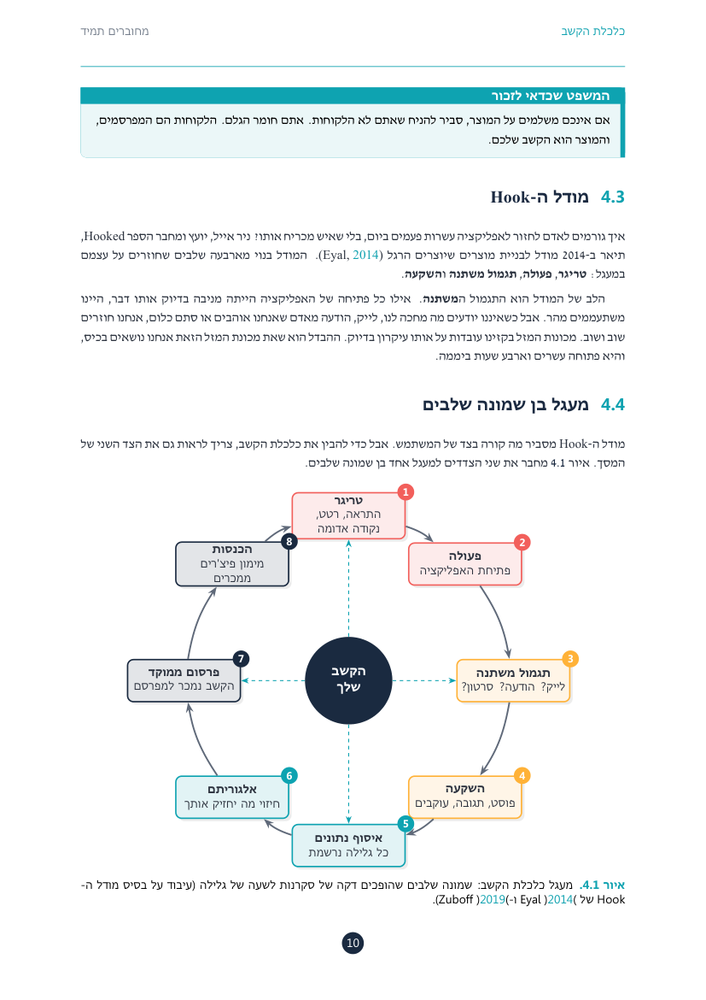
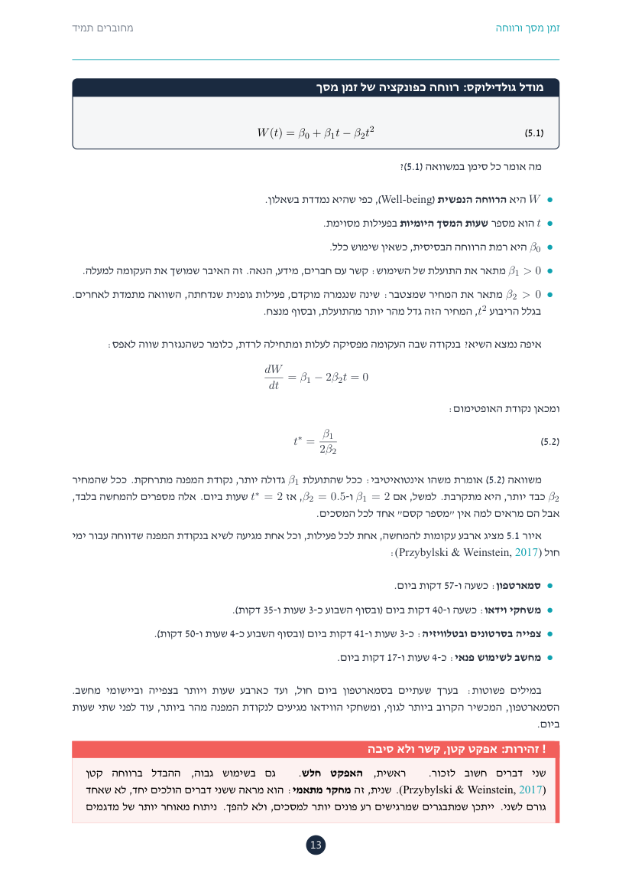
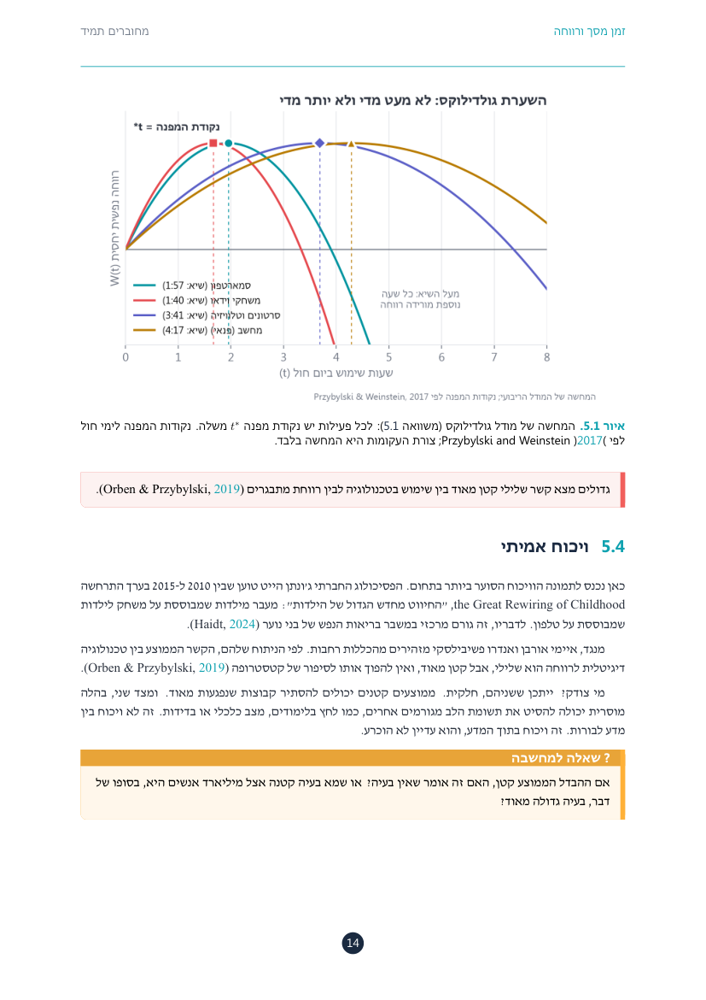

<div dir="rtl">

# 📱 מחוברים תמיד: טכנולוגיה וחיי היומיום

ספר מעוצב בעברית בהיקף של כ-25 עמודי תוכן. הוא נכתב ב-**LaTeX** (XeLaTeX) בשיטת **vibe coding**, על ידי צוות של **ארבעה סוכני AI**: Master שמנהל את הפרויקט, ומתחתיו חוקר, כותב ועורך.

> **שאלת הספר:** איך הסמארטפון, הרשתות החברתיות והבית החכם משנים את הדרך שבה אנחנו חיים, ואיך שומרים על איזון?
> הספר נכתב **בהשראת סגנון הכתיבה של יובל נח הררי**: מבט היסטורי רחב, משפטים קצרים ושאלות פתוחות לקורא.

📕 **[book.pdf](book.pdf)**: הספר הסופי (27 עמודים) &nbsp;|&nbsp; 📝 **[book.docx](book.docx)**: גרסת Word לעריכה &nbsp;|&nbsp; 📋 **[PRD.md](PRD.md)**: הגדרת הפרויקט

---

## 🖼️ צילומים מתוך הספר

| שער | תוכן עניינים | פתיחת פרק |
|:---:|:---:|:---:|
|  |  |  |
| **תרשים בלוקים (8 בלוקים, TikZ)** | **נוסחה בתיבה מעוצבת** | **גרף Python: השערת גולדילוקס** |
|  |  |  |
| **טבלה: ציר זמן** | **גרף Python: זמן יומי ברשת** | **רשימת תיוג ותיבות טיפים** |
|  |  |  |

<p align="center"><br><em>תרשים הבלוקים "מעגל כלכלת הקשב": 8 שלבים, צויר ב-TikZ</em></p>

---

## ✅ עמידה בדרישות המטלה

| דרישה | איך זה מומש | איפה |
|-------|-------------|------|
| ספר PDF בהיקף ~20 עמודים | 27 עמודים: שער, תקציר, תוכן עניינים, 8 פרקים ומקורות | [book.pdf](book.pdf) |
| LaTeX, קובץ נפרד לכל פרק | `main.tex` ראשי, ו-`\input` לכל פרק | [chapters/](chapters) |
| עברית | XeLaTeX + polyglossia, גופני David ו-Gisha, כיוון RTL | [style.sty](style.sty) |
| תוכן עניינים ותקציר | `\tableofcontents` מעוצב, ותקציר בעמוד נפרד | [00-abstract.tex](chapters/00-abstract.tex) |
| **גרף מ-Python** | **3 גרפים** ב-matplotlib, מנתונים מאומתים (ITU, DataReportal, Oxford) | [make_graphs.py](python/make_graphs.py) |
| **טבלה** | **2 טבלאות**: ציר זמן, וזמן יומי ברשת | פרקים 2, 3 |
| **נוסחה** | מודל גולדילוקס $W(t)=\beta_0+\beta_1t-\beta_2t^2$ וגזירת האופטימום $t^*=\beta_1/2\beta_2$ | פרק 5 |
| **תמונה** | שני איורים שנוצרו בקוד (generative art): שער ובית חכם | [make_images.py](python/make_images.py) |
| **תרשים בלוקים** | "מעגל כלכלת הקשב": 8 בלוקים ב-TikZ | [attention-loop.tex](chapters/figures/attention-loop.tex) |
| **עיצוב fancy** | 6 סוגי תיבות tcolorbox, כותרות פרק עם "נקודת התראה", תבליטים בעברית, רשימת תיוג, כותרות עמוד | [style.sty](style.sty) |
| **ביבליוגרפיה** | 16 מקורות אמיתיים, biblatex בסגנון APA | [refs.bib](refs.bib) |
| PRD | דרישות, מבנה פרקים, ארכיטקטורת סוכנים | [PRD.md](PRD.md) |
| פרומפטים | כל הפרומפטים לכל סוכן | [prompts/](prompts) |
| **3 סוכנים לפחות** | Master + חוקר + כותב + עורך | ראו למטה |

---

## 🤖 צוות הסוכנים

```
                 ┌──────────────────────────┐
                 │    MASTER (מנהל פרויקט)    │
                 │ PRD, עיצוב, גרפים, הידור,  │
                 │  תיקון באגים, Word, GitHub │
                 └────────────┬─────────────┘
          ┌───────────────────┼───────────────────┐
          ▼                   ▼                   ▼
 ┌────────────────┐  ┌────────────────┐  ┌────────────────┐
 │ סוכן 1: חוקר    │─▶│ סוכן 2: כותב    │─▶│ סוכן 3: עורך    │
 │ 16 מקורות,     │  │ 9 פרקים בסגנון │  │ 19 תיקונים,    │
 │ גיליון עובדות   │  │ יובל נח הררי    │  │ דו"ח עריכה      │
 └────────────────┘  └────────────────┘  └────────────────┘
```

| סוכן | תפקיד | פרומפט | תוצר |
|------|--------|---------|-------|
| **Master** | ניהול, עיצוב, Python, הידור, אינטגרציה | [00-master.md](prompts/00-master.md) | `PRD.md`, `style.sty`, גרפים, תרשים |
| **1: חוקר** | חיפוש מקורות ואימות כל מספר. פריטים שלא אומתו סומנו ולא שימשו כעובדה | [01-researcher.md](prompts/01-researcher.md) | [refs.bib](refs.bib), [facts.md](research/facts.md) |
| **2: כותב** | 9 פרקים בסגנון הררי, רק עם נתונים מגיליון העובדות | [02-writer.md](prompts/02-writer.md) | [chapters/](chapters) |
| **3: עורך** | בדיקת עובדות, שפה ודרישות, תיקון ישיר בקבצים וציון | [03-editor.md](prompts/03-editor.md) | [editor-report.md](research/editor-report.md) |

**איך הם עבדו יחד:** החוקר עבד במקביל ל-Master, שבזמן הזה בנה את העיצוב. ה-Master עדכן את הנחיות הכותב לפי מה שהחוקר הצליח ולא הצליח לאמת. העורך מצא 3 בעיות שהיו באחריות ה-Master (תיבת האפיגרף, ציטוטים הפוכים, היקף), וה-Master תיקן אותן.

---

## 🐞 באגים מעניינים שנפתרו בדרך

| בעיה | הסיבה | הפתרון |
|------|-------|--------|
| כל הגרפיקה (TikZ ותיבות) נעלמה מה-PDF | `bidi` (דרך polyglossia) נטענה לפני tikz | לטעון את polyglossia **אחרי** tikz, tcolorbox ו-hyperref |
| סדר מילים הפוך בתוך צמתי TikZ | צמתים מסודרים משמאל לימין | `text width` + `\RL{...}` לכל שורה |
| אותיות הפוכות בגרפים | matplotlib 3.11 כבר תומך ב-RTL, ו-python-bidi הפך את הטקסט שוב | הסרת python-bidi |
| ציטוטים באנגלית נשברו בסדר הפוך, עם סוגריים במראה | שמות לטיניים בתוך פסקה בעברית | עטיפת `\parencite` ב-`\textenglish` בתוך `\mbox` |
| תווים שבורים בתיבת האפיגרף | `\r` ו-`\f` בסקריפט Python פוענחו כתווי בקרה | מחרוזות raw (`r"..."`) |

---

## 🛠️ בנייה

**דרישות:** MiKTeX או TeX Live (XeLaTeX + biber), Python 3 + `matplotlib>=3.11 numpy pymupdf`, Node.js (לגרסת ה-Word).

```bash
bash build.sh            # גרפים → XeLaTeX → biber → XeLaTeX ×2 → book.pdf
node word/make_docx.js   # book.docx מתוך אותם קובצי .tex
```

## 📁 מבנה הפרויקט

```
latex-book/
├── main.tex                 ← הקובץ הראשי
├── style.sty                ← כל העיצוב: צבעים, תיבות, כותרות, גופנים
├── refs.bib                 ← 16 מקורות (נאספו ע"י סוכן החוקר)
├── chapters/
│   ├── cover.tex            ← עמוד שער (TikZ)
│   ├── 00-abstract.tex … 08-summary.tex   ← תקציר + 8 פרקים
│   └── figures/             ← עטיפות לאיורים + תרשים הבלוקים
├── python/
│   ├── make_graphs.py       ← 3 גרפים
│   ├── make_images.py       ← איור השער ואיור הבית החכם
│   └── render_pages.py      ← צילומי עמודים מה-PDF
├── images/                  ← כל התמונות שנוצרו
├── research/
│   ├── facts.md             ← גיליון עובדות מאומת
│   └── editor-report.md     ← דו"ח העורך
├── prompts/                 ← הפרומפטים של כל הסוכנים
├── word/make_docx.js        ← ממיר LaTeX → Word
├── docs/screenshots/        ← הצילומים ב-README
├── PRD.md · build.sh
├── book.pdf                 ← התוצר הסופי
└── book.docx                ← גרסת Word לעריכה
```

</div>
